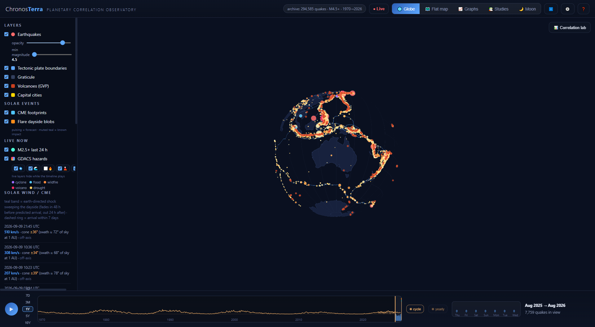
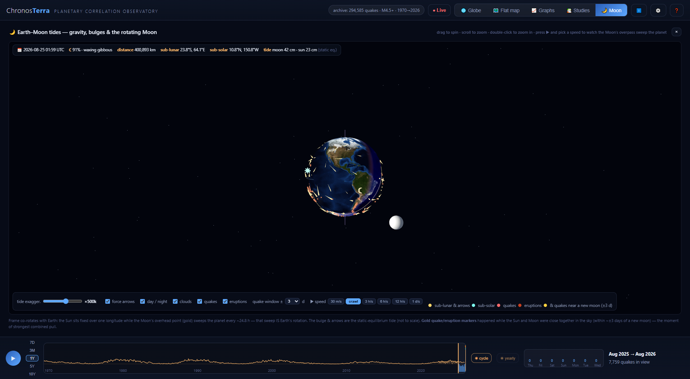

<div align="center">

# 🌋 Chronos‑Terra

### A planetary correlation observatory — earthquakes × solar activity × magnetosphere × tides

`1970 → present` &nbsp;·&nbsp; Windows portable desktop app &nbsp;·&nbsp; Electron + MapLibre + Canvas + Three.js


-5ea8ff)


</div>

---

**Chronos‑Terra asks an open question:** do solar‑terrestrial forces measurably correlate with seismic activity?
It bundles **56 years** of global seismicity and the full space‑weather stack — solar wind, IMF, geomagnetic indices —
into one offline‑capable desktop app, then lets *you* test the relationship graph‑by‑graph, with honest caveats on every estimate.

---

## 🖼️ Screenshots





---

## ✨ Feature highlights

| | |
| --- | --- |
| 🌐 | **Planetary map** — real‑time quakes (live USGS feed), volcanoes, tectonic plates, capitals, plus lunar/solar tidal overlay |
| 🌙 | **Earth–Moon tides view** — a 3‑D scene of the gravitational tide: sub‑lunar & sub‑solar points, equilibrium bulge + force arrows, honest real‑size readouts (≈53 cm lunar + ≈25 cm solar). 🔆 **Quakes & eruptions that happened within ±3 days of a new moon** (Sun & Moon on the same side — strongest combined pull) glow **bright gold**; toggle off in Settings |
| ⏯️ | **Watchable timeline** — press ▶ and pick a speed from **30 m/s** (glacial) up to 1 day/s; playing now *wraps* at the archive end instead of stopping |
| ☀️ | **Solar activity** — sunspot number, F10.7 flux, Ap/Kp geomagnetic indices (NOAA/GFZ bundled series) |
| 🧲 | **Magnetosphere wires** — bundled NASA OMNIWeb history (1970→now) *·theory*: proton density, IMF \|B\| & Bz, dynamic pressure, Dst, E‑field |
| 📈 | **Graphs view** — multi‑series overlays, independent y‑scaling, daily/monthly binning, hover inspection, range windowing |
| ⏳ | **Lag‑scan engine** — shifts each series pair across days *or* months to surface lead/lag structure (≈1‑day proton scale follows Marchitelli et al. 2020) |
| 🔄 | **Per‑type reload** — refresh any bundled magnetosphere series live from NASA OMNIWeb with local caching |
| ⚡ | **Live proton density** — streamed from NOAA ACE (10‑min cache TTL) |
| 📚 | **Studies & live news** — peer‑reviewed papers and fresh RSS feeds on sun, volcanoes & weather |
| 👁️ | **Focus views & Help** — full‑screen graph/study modes, dense rulers, floating date cursor, and a glossary‑backed Help screen |

## 🚀 Getting started

```bash
npm install        # electron + electron-builder
npm start          # run from source
npm run dist       # build the Windows portable .exe → dist/
npm run dist:mac   # macOS .dmg + .zip (x64 + arm64)
```

The portable build packages `data/` (all series) and `vendor/` (MapLibre, Three.js) inside the asar — **the archive views run fully offline**, no internet needed.

## ⚠️ Disclaimer

> This software is a **personal exploration of theoretical vectors** by an enthusiast with **no formal education** in seismology, geophysics, or astronomy — only a passing interest.
>
> Nothing in this project is peer‑reviewed science and **nothing here is a prediction**. The visualizations and correlation tools expose possible relationships for *curiosity and hypothesis generation only*. Using this tool — for any purpose whatsoever — is **entirely at your own responsibility**.

## 🗄️ Data provenance

| Series | Source | Notes |
| --- | --- | --- |
| Quakes catalog | USGS `query?format=geojson` | `.json.gz` bundled, filtered M4+ |
| Sunspots / F10.7 / Kp / Ap | SILSO + GFZ monthly table | bundled CSV/txt |
| Magnetosphere (6 series) | NASA OMNIWeb `nx1.cgi` (daily, OMNI2) | bundled `data/magnet/*.json`; refreshable in‑app |
| Live ACE proton density | NOAA SWPC `ace-swepam.txt` | 10‑min cache |

Reproduce the bundled magnetosphere series: `node tools/fetch_magnet.mjs`.

## 📁 Layout

```
app.js            main application logic (views, canvas rendering, live feeds, IPC)
moon.js           Moon / tides view: ephemeris, Three.js scene, syzygy windows
electron-main.js  main process: IPC, net fetches, archive dir, window
preload.js        contextBridge (window.ct)
index.html        single‑page UI
style.css         dark theme
data/             bundled archives + magnetosphere series (offline)
vendor/           MapLibre GL + Three.js + earth textures
tools/            data generators (fetch_magnet, build_volcs, merge_quakes)
tests/            PowerShell live‑endpoint smoke tests
.github/          GitHub Actions — macOS build (dmg + zip, x64 + arm64)
```

## 🧠 Design notes

- `app.js` and `moon.js` are hand‑rolled vanilla JS — no framework.
- Bundle quake catalog is the **historical archive**; the live USGS feed covers only a recent window; both aggregate per bin.
- All IPC payloads live under `window.ct` in the preload bridge; external fetches go through the main process (`net`) — CORS‑safe.
- Runtime cache `data_archive/` is created next to the app on first run; git‑ignored.
- Honest labeling: computed, bundled, or estimated series are tagged `·theory`.
- No native modules, no `process.platform` branches, no shell calls — trivially portable to macOS (x64 + ARM); unsigned builds require right‑click → Open.

## 🗺️ Roadmap

- [x] v0.15.x — focus views, denser rulers, cursor readout, Studies + live news, help system
- [x] v0.16.0 — Earth–Moon tides view, syzygy (new‑moon) event highlight, play‑wrap, speed presets down to 30 m/s
- [ ] macOS / ARM portable builds (CI workflow ready — see `.github/workflows/macos.yml`)
- [x] Correlation lab round 2 — day‑scale lag slider + significance band
- [x] Climate & extreme‑weather event layer on the timeline
- [x] Headless CDP smoke suite for build verification
- [x] Finding export — PNG with baked‑in caption + reproducible JSON sidecar
- [x] Saved views — capture/restore range, magnitude, region, series and lag
- [x] Data‑health badge — per‑feed availability and freshness
- [x] Graph event markers with hover tooltips
- [x] Trigger‑window engine — superposed epoch with 95 % shuffle envelope (moon, solar, quake, climate triggers)
- [x] Region‑filtered quake series (coarse latitude/longitude boxes)
- [x] Benjamini–Hochberg FDR across the scanned lags
- [x] A/B earlier‑window lag comparison overlay

## 📄 License

MIT — see [LICENSE](LICENSE). All bundled data remains property of its respective sources (USGS, NASA OMNIWeb, NOAA SWPC, SILSO, GFZ).